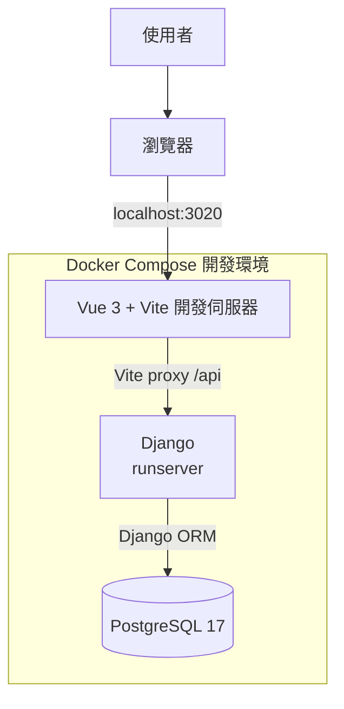
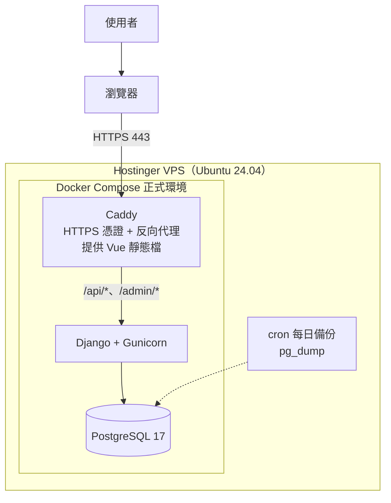
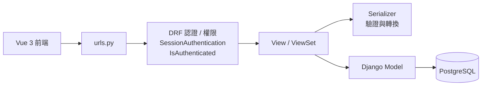

# 系統架構

## MVP 概觀

Trello Full Stack 是一個看板（Kanban）式的任務管理應用，採用前後端分離架構。使用者透過瀏覽器操作 Vue 3 前端，前端以 HTTP JSON 呼叫 Django REST Framework（DRF）提供的 REST API，API 透過 Django ORM 存取 PostgreSQL。本機開發與正式環境都用 Docker Compose 管理服務；正式環境部署在自己管理的 **Hostinger VPS（KVM 1）**。

資料的層級是 **看板（Board）→ 列表（List）→ 卡片（Card）**：一個使用者有多個看板，一個看板有多個列表（例如「待辦」「進行中」「完成」），一個列表有多張卡片，卡片可以在列表之間拖拉移動。

> **參考專案**：本專案以先前完成的 [todo-fullstack](https://github.com/annie-clickforce/todo-fullstack)（Vue 3 + Laravel 8 + MySQL，部署在 Hostinger 共享主機）為參考，全新建立、不複製其檔案。認證、資料隔離、Docker Compose、文件格式與部署流程都有可以對照的地方，各階段對應的參考位置見 [roadmap.md](roadmap.md) 的「📖 參考」。

### 本機開發



開發時瀏覽器只連 Vite（`localhost:3020`），`/api` 開頭的請求由 Vite 的 proxy 轉給 `api` 容器。對瀏覽器來說前端和 API 是**同一個來源（same origin）**，所以不需要設定 CORS，Session Cookie 與 CSRF Cookie 也不會有跨網域問題（Todo 專案踩過的 CORS／`SESSION_DOMAIN`／`SANCTUM_STATEFUL_DOMAINS` 這類問題都不會出現）。

### 正式環境（Hostinger VPS）



- **Caddy**：唯一對外的服務（只開放 80／443）。自動向 Let's Encrypt 申請與更新 HTTPS 憑證；`/api/*`、`/admin/*` 轉給 Django，其餘路徑提供 Vue 建置後的靜態檔（找不到的路徑回 `index.html`，交給 Vue Router）。
- **Django + Gunicorn**：Gunicorn 是正式環境用的 Python 應用伺服器（`runserver` 只能用在開發）。Django Admin 的靜態檔由 WhiteNoise 提供。
- **PostgreSQL**：只在 Docker 內部網路，**不對外開放連接埠**。
- 前端、API、後台都在同一個網域，一樣不需要 CORS。

## 技術選型

| 項目 | 選擇 | 理由 |
| --- | --- | --- |
| 前端 | Vue 3 + Vite + Vue Router | 沿用 Todo 專案的經驗。 |
| 拖拉排序 | `vuedraggable@next`（SortableJS 的 Vue 3 版本） | 列表、卡片拖拉的主流做法，支援跨容器拖拉。 |
| 後端 | Python 3.13 + Django 5.2 LTS + Django REST Framework | 認證、Session、CSRF、ORM、migration、後台管理都內建，適合 Trello 這類以 CRUD 與權限為主的應用。5.2 是長期支援版本（LTS）。在 Express、Laravel 之後再學一個後端生態系。 |
| 資料庫 | PostgreSQL 17 | Django 對 PostgreSQL 支援最完整；原生 `uuid` 型別、`timestamptz`，以及本專案排序要用到的**延遲檢查唯一約束**（deferrable unique constraint，見 [database.md](database.md)）。 |
| 認證 | Django 內建 Session 認證 + CSRF | Session 存在資料庫，瀏覽器只拿到 HTTP-only Cookie，概念跟 Todo 專案的 Sanctum SPA 認證一樣。 |
| 密碼雜湊 | Argon2（`argon2-cffi`） | Django 官方建議的最強選項，Todo 專案規格也要求 Argon2 或 bcrypt。 |
| 測試 | pytest + pytest-django | Python 最常見的測試工具；Todo 專案沒有自動化測試，這次補上。 |
| 程式碼檢查 | Ruff | 一個工具同時做 lint 與格式化，速度快。 |
| CI | GitHub Actions | 每次 push 自動跑 lint 與測試。 |
| 正式環境 | Hostinger VPS KVM 1 + Docker Compose + Caddy | 本機與正式環境用相同的容器；Caddy 自動處理 HTTPS，設定比 Nginx + certbot 簡單。 |

## 元件職責

| 元件 | 職責 |
| --- | --- |
| Vue 3 + Vite | 顯示看板清單與看板內容，提供看板、列表、卡片的新增、編輯、刪除，以及拖拉排序與跨列表移動卡片。 |
| Django + DRF | 提供 REST API、驗證請求資料、處理認證與 CSRF，並確保每個請求只能存取自己的看板資料。 |
| Django Admin | 開發與維運用的後台，可直接查看與修改資料（只有 superuser 能登入）。 |
| PostgreSQL | 保存使用者、看板、列表、卡片、Session，以及速率限制用的快取資料。 |
| Caddy | 正式環境的 HTTPS、反向代理與前端靜態檔。 |
| Docker Compose | 統一管理各服務與服務間的連線設定；開發與正式環境各一份設定檔。 |

## API 內部流程

請求依序經過 URL 設定、DRF 的認證與權限檢查，交給 View 處理，透過 Serializer 驗證輸入、轉換輸出，再由 Model 存取資料庫。目前以簡化結構實作，不另外拆 Service／Repository 層；唯一的例外是排序邏輯（多個 View 共用、需要大量測試），獨立放在 `boards/ordering.py`。



### 擁有權檢查

列表、卡片本身不存 `user_id`，擁有權要沿著層級往上追到看板：

- 看板：`Board.objects.filter(owner=request.user)`
- 列表：`BoardList.objects.filter(board__owner=request.user)`
- 卡片：`Card.objects.filter(list__board__owner=request.user)`

每個 View 的 `get_queryset()` **一開始就用擁有者過濾**，之後查單筆時查不到自然回 `404`。不要「先查出資料再判斷是不是自己的」，避免漏判；也不要回 `403`，以免洩漏「這筆資料存在」。每支端點都要有自動化測試，確認用另一個帳號存取會回 `404`。

## 卡片移動流程


鎖定看板是為了避免兩個請求（例如兩個分頁）同時移動同一個看板裡的卡片，讓 position 算錯。排序規則詳見 [database.md](database.md)「排序（position）」。

## 目錄結構（規劃）

```text
trello-fullstack/
├─ docker-compose.yml          # 本機開發
├─ docker-compose.prod.yml     # 正式環境
├─ Caddyfile
├─ .env.example
├─ .github/workflows/ci.yml
├─ backend/
│  ├─ Dockerfile
│  ├─ requirements.txt
│  ├─ requirements-dev.txt     # pytest、ruff 等開發工具
│  ├─ pyproject.toml           # pytest、ruff 設定
│  ├─ manage.py
│  ├─ config/                  # Django 專案設定：settings.py、urls.py、wsgi.py
│  ├─ accounts/                # 自訂使用者模型、註冊／登入／登出
│  └─ boards/                  # Board、BoardList、Card、排序邏輯（ordering.py）
│     └─ tests/
├─ frontend/
│  ├─ Dockerfile
│  ├─ vite.config.js           # 開發時 proxy /api → api 容器
│  └─ src/
├─ deploy/
│  └─ backup.sh                # 資料庫備份腳本
└─ docs/
```

## Docker 服務

本機開發（`docker-compose.yml`）：

| 服務 | 用途 | 對外連接埠 |
| --- | --- | --- |
| `frontend` | 執行 Vue 3 開發伺服器 | `3020` |
| `api` | 執行 Django 開發伺服器（`runserver`） | `3021`（也可以在這裡開 `/admin/`） |
| `db` | 執行 PostgreSQL 17 與保存資料 | `5433`（可用根目錄 `.env` 的 `POSTGRES_PORT` 調整） |

連接埠刻意跟 Todo 專案（`3010`／`3011`／`3306`）以及電腦上可能已安裝的 PostgreSQL（`5432`）錯開。API 在 Docker 內透過 `db:5432` 連線；對外的 `5433` 只給 DBeaver 之類的工具用。

正式環境（`docker-compose.prod.yml`）：

| 服務 | 用途 | 對外連接埠 |
| --- | --- | --- |
| `caddy` | HTTPS、反向代理、Vue 靜態檔（映像檔建置時會先編譯前端） | `80`、`443` |
| `api` | Django + Gunicorn | 不對外 |
| `db` | PostgreSQL 17 | **不對外** |

> ⚠️ Docker 對外開放的連接埠會**繞過 ufw 防火牆**。正式環境的 `db`、`api` 絕對不要寫 `ports:`，只有 `caddy` 可以對外。

## 第一階段範圍（MVP）

- 註冊、登入、登出，以及使用者權限（只能存取自己的看板與底下的列表、卡片）。
- 看板 CRUD。
- 列表 CRUD 與排序。
- 卡片 CRUD、排序，以及在同一個看板內跨列表移動。
- Vue 3 前端與 REST API 串接，包含拖拉操作。
- 後端自動化測試與 GitHub Actions CI。
- 部署到 Hostinger VPS，包含 HTTPS、防火牆與每日資料庫備份。

## 後續規劃

以下先不納入 MVP，待上述功能完成後再評估：

- 看板成員共享（邀請其他使用者一起編輯）。加入後權限會從「只有自己」變成「看板成員」，資料表與每支 API 的擁有權檢查都要調整，是複雜度最高的一項。
- 卡片標籤、到期日、指派成員、留言、附件、勾選清單。
- 封存（archive）看板／列表／卡片，取代直接刪除。
- 即時同步（多個分頁或多人同時操作時自動更新），可用 Django Channels + WebSocket。
- 忘記密碼／重設密碼（需要寄信服務）。
- 自動部署（CD）：CI 通過後自動部署到 VPS。

完整 API 規格見 [api.md](api.md)，資料模型見 [database.md](database.md)，開發步驟見 [roadmap.md](roadmap.md)。

## 待確認事項

- [ ] 購買 Hostinger VPS KVM 1（確認首期與續約價格、付款週期）。
- [ ] 網域：沿用現有網域的子網域（例如 `trello.你的網域`），或另外購買。
- [ ] Todo 專案要不要之後也搬到這台 VPS，讓共享主機方案到期後不用續約。
