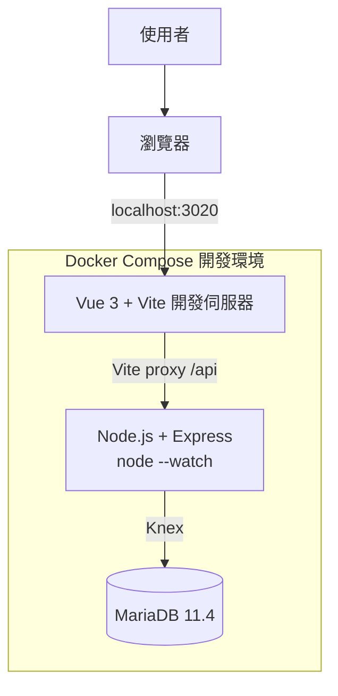
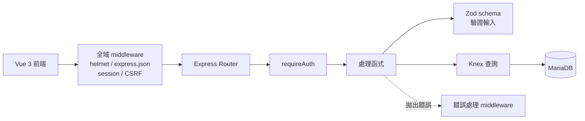
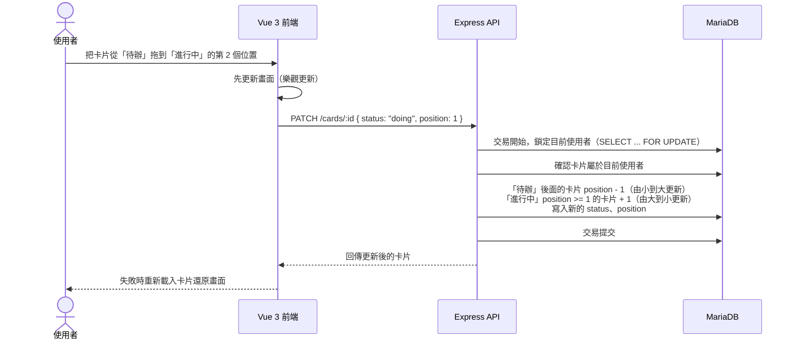

# 系統架構

## MVP 概觀

Trello Full Stack 是一個看板（Kanban）式的任務管理應用，採用前後端分離架構。使用者透過瀏覽器操作 Vue 3 前端，前端以 HTTP JSON 呼叫 Node.js（Express 5）提供的 REST API，API 透過 Knex（SQL query builder）存取 MariaDB。本機開發用 Docker Compose 管理所有服務。本專案先專注在本機完成全端功能，部署（Hostinger Unlimited Web Hosting 的 Node.js Web App）等功能完成後再進行，架構與步驟見 [deployment.md](deployment.md)。

看板固定分成 **待辦、進行中、完成** 三欄，每個使用者只有自己的一個看板。卡片就像待辦事項，有標題與說明，可以新增、就地編輯、刪除，也可以在欄內拖拉排序、拖到其他欄。欄位是固定的，不能新增或改名，所以資料只有兩層：**使用者 → 卡片**，卡片用 `status` 欄位記錄在哪一欄。

### 本機開發



開發時瀏覽器只連 Vite（`localhost:3020`），`/api` 開頭的請求由 Vite 的 proxy 轉給 `api` 容器。對瀏覽器來說前端和 API 是**同一個來源（same origin）**，所以不需要設定 CORS，Session Cookie 與 CSRF Cookie 也不會有跨網域問題。正式環境由 Express 同時提供 Vue 建置檔與 API，一樣是同一個來源（見 [deployment.md](deployment.md)）。

本專案沒有內建的管理後台，開發時直接用 DBeaver 連 `localhost:3308` 查看與修改資料。

## 技術選型

| 項目 | 選擇 | 理由 |
| --- | --- | --- |
| 前端 | Vue 3 + Vite + Vue Router | 輕量、上手快，單頁應用的路由與狀態管理都很直接。 |
| 拖拉排序 | `vuedraggable@next`（SortableJS 的 Vue 3 版本） | 拖拉排序的主流做法，支援跨欄拖拉。 |
| 後端 | Node.js 24 LTS + Express 5（JavaScript，ES Modules） | 前後端同一種語言；Express 5 會自動把 async 函式拋出的錯誤交給錯誤處理 middleware，不用每支都包 `try/catch`。24 是長期支援版本（LTS），維護到 2028 年 4 月。 |
| 資料庫存取 | Knex（query builder + migration）+ `mysql2` 驅動 | SQL 看得見、交易、`SELECT ... FOR UPDATE`、`UPDATE ... ORDER BY` 寫起來都直接；比完整 ORM 更能看出對 SQL 與資料庫的掌握。 |
| 資料庫 | MariaDB 11.4 LTS | Hostinger 的主機方案只提供 MariaDB／MySQL，本機與正式環境用同一種資料庫，才不會本機測過、上線才壞。InnoDB 支援交易、外鍵、列鎖定；管理工具（DBeaver、phpMyAdmin）選擇多。排序在 MariaDB 下的做法見 [database.md](database.md)「排序」。 |
| 輸入驗證 | Zod | 用宣告的方式描述欄位規則，驗證失敗時拿得到每個欄位的錯誤，方便轉成 API 的錯誤格式。 |
| 認證 | `express-session` + `express-mysql-session` | Session 存在 MariaDB，瀏覽器只拿到 HTTP-only Cookie，前端不用自己保存 token；API 本身不存狀態。 |
| CSRF | 自己寫的 middleware（Synchronizer Token） | Express 沒有內建 CSRF 保護。token 存在 Session、用 `crypto` 產生與比對，大約二十行程式，自己寫可以完整理解原理（流程見 [api.md](api.md)「CSRF」）。 |
| 密碼雜湊 | Argon2（`argon2` 套件） | OWASP 建議的首選演算法。 |
| 速率限制 | `express-rate-limit` | 登入、註冊防暴力嘗試。 |
| 安全標頭 | `helmet` | 一次加上常見的安全性 HTTP 標頭。 |
| 正式環境 | Hostinger Unlimited Web Hosting（Node.js Web App + MariaDB） | 代管主機直接執行 Node.js，HTTPS、網域、備份、系統更新都由 Hostinger 處理；正式環境不用 Docker。詳見 [deployment.md](deployment.md)。 |

## 元件職責

| 元件 | 職責 |
| --- | --- |
| Vue 3 + Vite | 顯示三欄看板，提供卡片的新增、就地編輯、刪除（含確認視窗），以及拖拉排序與跨欄移動。 |
| Node.js + Express | 提供 REST API、驗證請求資料、處理認證與 CSRF，並確保每個請求只能存取自己的卡片。 |
| MariaDB | 保存使用者、卡片與 Session。 |
| Docker Compose | 統一管理本機開發的各服務與服務間的連線設定。 |

## API 內部流程

請求依序經過全域 middleware（安全標頭、JSON 解析、Session、CSRF），再由路由對應到處理函式。需要登入的路由先經過 `requireAuth` middleware；處理函式用 Zod schema 驗證輸入，用 Knex 存取資料庫，最後把資料轉成 API 的回應格式。任何地方拋出的錯誤都交給最後的錯誤處理 middleware，統一轉成 [api.md](api.md) 的錯誤格式。

目前以簡化結構實作（Route → 處理函式 → Zod schema → Knex），不另外拆 Service／Repository 層；唯一的例外是排序邏輯（新增、移動、刪除都會用到，邏輯最容易出錯），獨立放在 `src/ordering.js`。



### 擁有權檢查

每張卡片都存了 `user_id`，所以所有卡片查詢都直接加上 `WHERE user_id = :userId`（`userId` 取自 Session）。查單張卡片的邏輯包成 `findOwnedCard(db, userId, id)`，**查詢條件一開始就帶上擁有者**，查不到就回 `404`。不要「先查出資料再判斷是不是自己的」，避免漏判；也不要回 `403`，以免洩漏「這筆資料存在」。每支端點都要確認用另一個帳號存取會回 `404`。

## 卡片移動流程



鎖定使用者是為了避免兩個請求（例如兩個分頁）同時移動同一個人的卡片，讓 position 算錯；更新時指定順序，是因為 MariaDB 每更新一列就檢查唯一約束。排序規則詳見 [database.md](database.md)「排序（position）」。

## 目錄結構（規劃）

```text
trello-fullstack/
├─ docker-compose.yml          # 本機開發
├─ .env.example
├─ package.json                # 正式環境（Hostinger Web App）的 build、start 入口
├─ backend/
│  ├─ Dockerfile
│  ├─ package.json             # "type": "module"；scripts：dev、start、migrate
│  ├─ knexfile.js              # Knex 連線與 migration 設定（讀 DB_* 環境變數）
│  ├─ migrations/              # Knex migration 檔
│  ├─ src/
│  │  ├─ server.js             # 讀 PORT 並啟動 HTTP 伺服器
│  │  ├─ app.js                # 建立 Express app、掛 middleware 與路由
│  │  ├─ config.js             # 讀取並檢查環境變數
│  │  ├─ db.js                 # Knex 實例
│  │  ├─ middleware/           # requireAuth、CSRF、Content-Type 檢查、錯誤處理
│  │  ├─ routes/               # health、auth、cards
│  │  ├─ schemas/              # Zod schema
│  │  └─ ordering.js           # 排序邏輯
├─ frontend/
│  ├─ Dockerfile
│  ├─ vite.config.js           # 開發時 proxy /api → api 容器
│  └─ src/
└─ docs/
```

`app.js` 與 `server.js` 分開：`app.js` 只建立並匯出 app，`server.js` 負責讀 `PORT` 並 `listen()`，啟動方式和 app 本身的設定互不干擾。

## Docker 服務

本機開發（`docker-compose.yml`）：

| 服務 | 用途 | 對外連接埠 |
| --- | --- | --- |
| `frontend` | 執行 Vue 3 開發伺服器 | `3020` |
| `api` | 執行 Express（`node --watch src/server.js`，容器內 port `3000`） | `3021` |
| `db` | 執行 MariaDB 11.4 與保存資料 | `3308`（可用根目錄 `.env` 的 `DB_PORT_HOST` 調整） |

連接埠刻意避開常見的預設值（例如 `3306`、`3307`），不會跟電腦上其他專案或已安裝的資料庫衝突。API 在 Docker 內透過 `db:3306` 連線；對外的 `3308` 只給 DBeaver 之類的工具用。

## MVP 範圍

- 註冊、登入、登出，以及使用者權限（只能存取自己的卡片）。
- 固定三欄（待辦、進行中、完成）的看板。
- 從看板上方的表單新增卡片（放進「待辦」最上面），卡片可以就地編輯（標題、說明），刪除前跳出確認視窗。
- 卡片在欄內拖拉排序、拖到其他欄。
- Vue 3 前端與 REST API 串接。
- 本機以 Docker Compose 一鍵啟動完整環境。

部署（Hostinger Web App、HTTPS、資料庫備份）在 MVP 功能完成後進行，見 [deployment.md](deployment.md)。

完整 API 規格見 [api.md](api.md)，資料模型見 [database.md](database.md)，開發步驟見 [roadmap.md](roadmap.md)，部署見 [deployment.md](deployment.md)。
