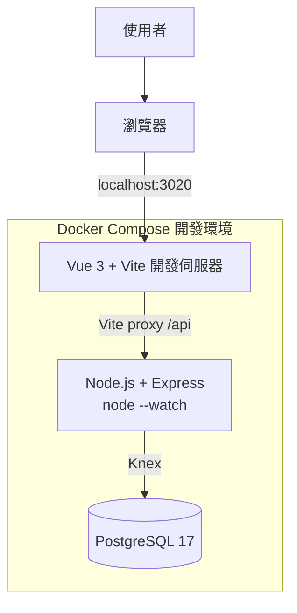
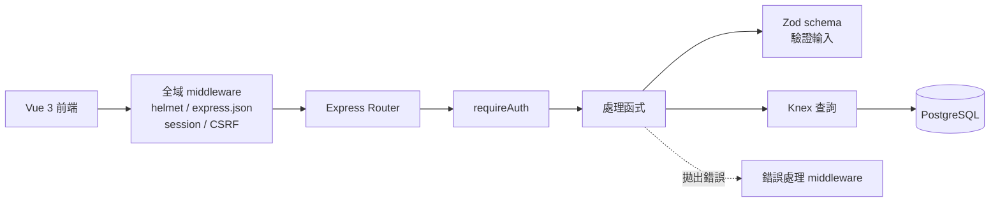
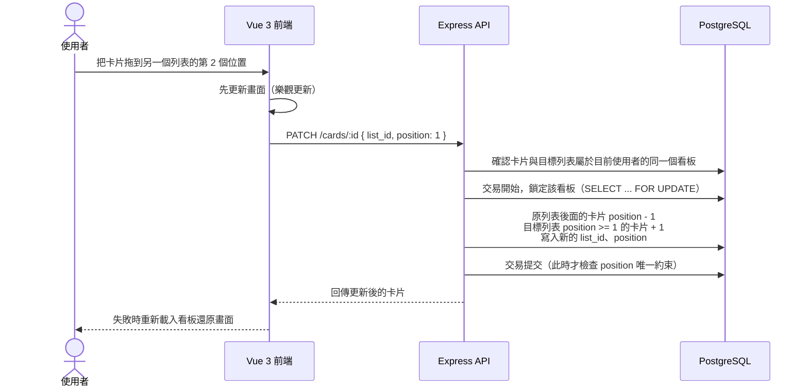

# 系統架構

## MVP 概觀

Trello Full Stack 是一個看板（Kanban）式的任務管理應用，採用前後端分離架構。使用者透過瀏覽器操作 Vue 3 前端，前端以 HTTP JSON 呼叫 Node.js（Express 5）提供的 REST API，API 透過 Knex（SQL query builder）存取 PostgreSQL。本機開發與正式環境都用 Docker Compose 管理服務；正式環境部署在自己管理的 **Hostinger VPS（KVM 1）**，並保留之後搬到雲端平台的彈性（見下方「雲端可攜性」）。

資料的層級是 **看板（Board）→ 列表（List）→ 卡片（Card）**：一個使用者有多個看板，一個看板有多個列表（例如「待辦」「進行中」「完成」），一個列表有多張卡片，卡片可以在列表之間拖拉移動。

> **參考專案**：本專案以先前完成的 [todo-fullstack](https://github.com/annie-clickforce/todo-fullstack)（Vue 3 + Laravel 8 + MySQL，部署在 Hostinger 共享主機；`backend/` 另有更早的 Express + PostgreSQL 版本）為參考，全新建立、不複製其檔案。認證、資料隔離、Docker Compose、文件格式與部署流程都有可以對照的地方，各階段對應的參考位置見 [roadmap.md](roadmap.md) 的「📖 參考」。

### 本機開發



開發時瀏覽器只連 Vite（`localhost:3020`），`/api` 開頭的請求由 Vite 的 proxy 轉給 `api` 容器。對瀏覽器來說前端和 API 是**同一個來源（same origin）**，所以不需要設定 CORS，Session Cookie 與 CSRF Cookie 也不會有跨網域問題（Todo 專案踩過的 CORS／`SESSION_DOMAIN`／`SANCTUM_STATEFUL_DOMAINS` 這類問題都不會出現）。

### 正式環境（Hostinger VPS）


- **Caddy**：唯一對外的服務（只開放 80／443）。自動向 Let's Encrypt 申請與更新 HTTPS 憑證；`/api/*` 轉給 API，其餘路徑提供 Vue 建置後的靜態檔（找不到的路徑回 `index.html`，交給 Vue Router）。
- **Node.js + Express**：正式環境直接用 `node src/server.js` 執行（開發時才用 `node --watch` 自動重啟）。Node.js 是單一行程，一個容器就是一個 API 實例。
- **PostgreSQL**：只在 Docker 內部網路，**不對外開放連接埠**。
- 前端與 API 在同一個網域，一樣不需要 CORS。
- 沒有像 Django Admin 那樣的內建後台；開發與維運時直接用 DBeaver（本機）或 `psql`（VPS 上 `docker compose exec db psql`）查看資料。

## 技術選型

| 項目 | 選擇 | 理由 |
| --- | --- | --- |
| 前端 | Vue 3 + Vite + Vue Router | 沿用 Todo 專案的經驗。 |
| 拖拉排序 | `vuedraggable@next`（SortableJS 的 Vue 3 版本） | 列表、卡片拖拉的主流做法，支援跨容器拖拉。 |
| 後端 | Node.js 24 LTS + Express 5（JavaScript，ES Modules） | 前後端同一種語言；Express 5 會自動把 async 函式拋出的錯誤交給錯誤處理 middleware，不用每支都包 `try/catch`。24 是長期支援版本（LTS），維護到 2028 年 4 月。Todo 專案的 `backend/` 已經用過 Express，這次在它的基礎上補齊交易、權限、測試與部署。 |
| 資料庫存取 | Knex（query builder + migration）+ `pg` 驅動 | SQL 看得見、交易與 `SELECT ... FOR UPDATE` 寫起來直接，migration 也能建立本專案排序要用的**延遲檢查唯一約束**；比完整 ORM 更能看出對 SQL 與資料庫的掌握。 |
| 資料庫 | PostgreSQL 17 | 原生 `uuid` 型別、`timestamptz`、`gen_random_uuid()`，以及延遲檢查唯一約束（deferrable unique constraint，見 [database.md](database.md)）。各家雲端都有代管版本（見「雲端可攜性」）。 |
| 輸入驗證 | Zod | 用宣告的方式描述欄位規則，驗證失敗時拿得到每個欄位的錯誤，方便轉成 API 的錯誤格式。 |
| 認證 | `express-session` + `connect-pg-simple` | Session 存在 PostgreSQL，瀏覽器只拿到 HTTP-only Cookie，概念跟 Todo 專案的 Sanctum SPA 認證一樣；API 容器本身不存狀態。 |
| CSRF | 自己寫的 middleware（Synchronizer Token） | Express 沒有內建 CSRF 保護。token 存在 Session、用 `crypto` 產生與比對，大約二十行程式，自己寫可以完整理解原理（流程見 [api.md](api.md)「CSRF」）。 |
| 密碼雜湊 | Argon2（`argon2` 套件） | OWASP 建議的首選演算法，Todo 專案規格也要求 Argon2 或 bcrypt。 |
| 速率限制 | `express-rate-limit` | 登入、註冊防暴力嘗試。 |
| 安全標頭 | `helmet` | 一次加上常見的安全性 HTTP 標頭。 |
| 測試 | Vitest + Supertest | Vitest 原生支援 ES Modules、速度快；Supertest 直接對 Express app 發請求，不用真的開 port。Todo 專案沒有自動化測試，這次補上。 |
| 程式碼檢查 | ESLint + Prettier | ESLint 抓錯誤寫法，Prettier 統一格式。 |
| CI | GitHub Actions | 每次 push 自動跑 lint 與測試。 |
| 正式環境 | Hostinger VPS KVM 1 + Docker Compose + Caddy | 本機與正式環境用相同的容器；Caddy 自動處理 HTTPS，設定比 Nginx + certbot 簡單。 |

## 雲端可攜性

目前部署在自己管理的 VPS，但設計上保留之後改用雲端平台（例如 Google Cloud Run、AWS ECS／App Runner 搭配代管 PostgreSQL，或申請雲端新創方案的額度）的彈性。為此遵守下列原則（大致就是 [Twelve-Factor App](https://12factor.net/) 的做法）：

- **API 不存狀態**：Session 存在 PostgreSQL，不存在記憶體或本機檔案；容器隨時可以重建、也可以同時跑多個。
- **設定全部來自環境變數**：資料庫用 `DATABASE_URL` 一個字串連線，換成雲端代管資料庫只要改這個值；程式碼裡不寫死任何主機、密碼。
- **同一個 Docker 映像檔**：API 的映像檔不依賴 VPS 上的任何東西，在 Docker Compose、Cloud Run、ECS 都能直接跑。監聽的 port 讀 `PORT` 環境變數（Cloud Run 會自動注入）。
- **migration 是獨立指令**（`npm run migrate`），不在 API 啟動時自動執行，換平台時可以改成部署前的一個步驟。
- **log 一律輸出到 stdout／stderr**，由 Docker 或雲端平台收集，不寫 log 檔。
- **健康檢查**（`GET /api/v1/health`）可以直接給雲端的負載平衡器或容器平台使用。
- **已知的單機假設**：速率限制先用記憶體計數（單一 API 容器時是準的）；之後如果同時跑多個實例，要改成共享的 store（PostgreSQL 或 Redis），否則每個實例各算各的。

Caddy、cron 備份這兩個是 VPS 專屬的部分，搬到雲端時由平台的 HTTPS／負載平衡與代管資料庫的自動備份取代；前端靜態檔可以改放物件儲存＋CDN，或繼續由一個小容器提供（要維持同網域，才不需要 CORS）。

## 元件職責

| 元件 | 職責 |
| --- | --- |
| Vue 3 + Vite | 顯示看板清單與看板內容，提供看板、列表、卡片的新增、編輯、刪除，以及拖拉排序與跨列表移動卡片。 |
| Node.js + Express | 提供 REST API、驗證請求資料、處理認證與 CSRF，並確保每個請求只能存取自己的看板資料。 |
| PostgreSQL | 保存使用者、看板、列表、卡片與 Session。 |
| Caddy | 正式環境的 HTTPS、反向代理與前端靜態檔。 |
| Docker Compose | 統一管理各服務與服務間的連線設定；開發與正式環境各一份設定檔。 |

## API 內部流程

請求依序經過全域 middleware（安全標頭、JSON 解析、Session、CSRF），再由路由對應到處理函式。需要登入的路由先經過 `requireAuth` middleware；處理函式用 Zod schema 驗證輸入，用 Knex 存取資料庫，最後把資料轉成 API 的回應格式。任何地方拋出的錯誤都交給最後的錯誤處理 middleware，統一轉成 [api.md](api.md) 的錯誤格式。

目前以簡化結構實作（Route → 處理函式 → Zod schema → Knex），不另外拆 Service／Repository 層；唯一的例外是排序邏輯（多個路由共用、需要大量測試），獨立放在 `src/ordering.js`。



### 擁有權檢查

列表、卡片本身不存 `user_id`，擁有權要沿著層級往上追到看板，所以查詢列表、卡片時一律 `JOIN` 到 `boards` 並加上擁有者條件：

- 看板：`WHERE boards.owner_id = :userId`
- 列表：`lists JOIN boards ON boards.id = lists.board_id WHERE boards.owner_id = :userId`
- 卡片：`cards JOIN lists ... JOIN boards ... WHERE boards.owner_id = :userId`

這些查詢包成幾個共用函式（例如 `findOwnedBoard(db, userId, id)`、`findOwnedList(...)`、`findOwnedCard(...)`），**查詢條件一開始就帶上擁有者**，查不到就回 `404`。不要「先查出資料再判斷是不是自己的」，避免漏判；也不要回 `403`，以免洩漏「這筆資料存在」。每支端點都要有自動化測試，確認用另一個帳號存取會回 `404`。

## 卡片移動流程



鎖定看板是為了避免兩個請求（例如兩個分頁）同時移動同一個看板裡的卡片，讓 position 算錯。排序規則詳見 [database.md](database.md)「排序（position）」。

## 目錄結構（規劃）

```text
trello-fullstack/
├─ docker-compose.yml          # 本機開發
├─ docker-compose.prod.yml     # 正式環境
├─ Caddyfile
├─ .env.example
├─ .github/workflows/ci.yml
├─ backend/
│  ├─ Dockerfile
│  ├─ package.json             # "type": "module"；scripts：dev、start、migrate、test、lint
│  ├─ knexfile.js              # Knex 連線與 migration 設定（讀 DATABASE_URL）
│  ├─ eslint.config.js
│  ├─ vitest.config.js
│  ├─ migrations/              # Knex migration 檔
│  ├─ src/
│  │  ├─ server.js             # 讀 PORT 並啟動 HTTP 伺服器
│  │  ├─ app.js                # 建立 Express app、掛 middleware 與路由（測試直接 import 這支）
│  │  ├─ config.js             # 讀取並檢查環境變數
│  │  ├─ db.js                 # Knex 實例
│  │  ├─ middleware/           # requireAuth、CSRF、Content-Type 檢查、錯誤處理
│  │  ├─ routes/               # health、auth、boards、lists、cards
│  │  ├─ schemas/              # Zod schema
│  │  ├─ ownership.js          # findOwnedBoard／findOwnedList／findOwnedCard
│  │  └─ ordering.js           # 排序邏輯
│  └─ tests/
├─ frontend/
│  ├─ Dockerfile
│  ├─ vite.config.js           # 開發時 proxy /api → api 容器
│  └─ src/
├─ deploy/
│  └─ backup.sh                # 資料庫備份腳本
└─ docs/
```

`app.js` 與 `server.js` 分開：`app.js` 只建立並匯出 app，不呼叫 `listen()`，測試時 Supertest 直接拿它發請求。

## Docker 服務

本機開發（`docker-compose.yml`）：

| 服務 | 用途 | 對外連接埠 |
| --- | --- | --- |
| `frontend` | 執行 Vue 3 開發伺服器 | `3020` |
| `api` | 執行 Express（`node --watch src/server.js`，容器內 port `3000`） | `3021` |
| `db` | 執行 PostgreSQL 17 與保存資料 | `5433`（可用根目錄 `.env` 的 `POSTGRES_PORT` 調整） |

連接埠刻意跟 Todo 專案（`3010`／`3011`／`3306`）以及電腦上可能已安裝的 PostgreSQL（`5432`）錯開。API 在 Docker 內透過 `db:5432` 連線；對外的 `5433` 只給 DBeaver 之類的工具用。

正式環境（`docker-compose.prod.yml`）：

| 服務 | 用途 | 對外連接埠 |
| --- | --- | --- |
| `caddy` | HTTPS、反向代理、Vue 靜態檔（映像檔建置時會先編譯前端） | `80`、`443` |
| `api` | Node.js + Express（`node src/server.js`） | 不對外 |
| `db` | PostgreSQL 17 | **不對外** |

> ⚠️ Docker 對外開放的連接埠會**繞過 ufw 防火牆**。正式環境的 `db`、`api` 絕對不要寫 `ports:`，只有 `caddy` 可以對外。

## 第一階段範圍（MVP）

- 註冊、登入、登出，以及使用者權限（只能存取自己的看板與底下的列表、卡片）。
- 看板 CRUD。
- 列表 CRUD 與排序。
- 卡片 CRUD、排序，以及在同一個看板內跨列表移動。
- Vue 3 前端與 REST API 串接，包含拖拉操作。
- 後端自動化測試與 GitHub Actions CI。
- 部署到 Hostinger VPS，包含 HTTPS、防火牆與每日資料庫備份。

## 後續規劃

以下先不納入 MVP，待上述功能完成後再評估：

- 看板成員共享（邀請其他使用者一起編輯）。加入後權限會從「只有自己」變成「看板成員」，資料表與每支 API 的擁有權檢查都要調整，是複雜度最高的一項。
- 卡片標籤、到期日、指派成員、留言、附件、勾選清單。
- 封存（archive）看板／列表／卡片，取代直接刪除。
- 即時同步（多個分頁或多人同時操作時自動更新），可用 WebSocket（例如 `ws` 或 Socket.IO）。
- 忘記密碼／重設密碼（需要寄信服務）。
- 自動部署（CD）：CI 通過後自動部署到 VPS。
- 搬到雲端平台（見「雲端可攜性」）。

完整 API 規格見 [api.md](api.md)，資料模型見 [database.md](database.md)，開發步驟見 [roadmap.md](roadmap.md)。

## 待確認事項

- [ ] 購買 Hostinger VPS KVM 1（確認首期與續約價格、付款週期）。
- [ ] 網域：沿用現有網域的子網域（例如 `trello.你的網域`），或另外購買。
- [ ] Todo 專案要不要之後也搬到這台 VPS，讓共享主機方案到期後不用續約。
