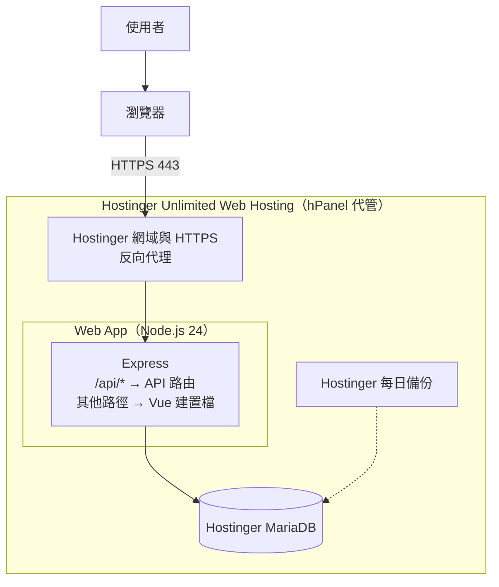

# 部署規劃

本文件描述把本專案部署上線的架構與步驟。**部署要等 [roadmap.md](roadmap.md) 的本機開發全部完成後才進行**；開發期間只要遵守下方「開發時就要遵守的原則」，之後部署就不需要回頭改程式。

部署目標是 **Hostinger Unlimited Web Hosting**：用 hPanel 的 **Web App**（Node.js 應用程式）執行 Express，資料庫用 Hostinger 提供的 MariaDB，HTTPS 與網域由 Hostinger 代管。正式環境**不使用 Docker Compose，也沒有 Caddy**；Docker 只用在本機開發。

> 標記說明：完成並實際測過的步驟，在步驟前加上 ✅️。

## 開發時就要遵守的原則

這些原則讓同一份程式碼可以跑在本機 Docker 與 Hostinger Web App，在本機開發時就要做到：

- **資料庫統一用 MariaDB**，只使用 MariaDB 10.6 與 MySQL 8.0 都支援的功能（見 [database.md](database.md)「相容性」）。Hostinger 提供的資料庫版本不一定跟本機的 11.4 一樣新。
- **API 不存狀態**：Session 存在資料庫，不存在記憶體或本機檔案；程式也不寫任何本機檔案（上傳、log 檔都不寫）。
- **設定全部來自環境變數**：資料庫連線用 `DB_HOST`、`DB_PORT`、`DB_NAME`、`DB_USER`、`DB_PASSWORD`，監聽的 port 讀 `PORT`；程式碼裡不寫死任何主機（例如 Docker 的 `db`）、密碼。程式不讀 `.env` 檔，本機由 Docker Compose 帶入，正式環境在 hPanel 的 Web App 設定環境變數。
- **正式環境才需要的設定也用環境變數開關**：Cookie 的 `secure` 由 `COOKIE_SECURE=true` 打開，Express 的 `trust proxy` 由 `TRUST_PROXY=1` 設定（API 前面有幾層反向代理就填幾），Express 提供前端檔案由 `FRONTEND_DIST` 打開。本機開發不設定（預設關閉）。錯誤訊息一律不回傳細節，本機與正式環境相同。
- **程式碼不依賴 Docker**：`npm ci && npm start` 在任何裝了 Node.js 24 的地方都要能跑。
- **migration 是獨立指令**（`npm run migrate`），不在 API 啟動時自動執行。
- **log 一律輸出到 stdout／stderr**，由 Hostinger 的 Web App 收集。
- **健康檢查**（`GET /api/v1/health`）用來確認 API 與資料庫正常。

## 正式環境架構（Hostinger Unlimited Web Hosting）

- **Hostinger 網域與 HTTPS**：在 hPanel 綁定網域、開啟 SSL，憑證由 Hostinger 自動申請與更新。請求經過 Hostinger 的反向代理再轉給 Web App，所以要設定 `TRUST_PROXY`。
- **Web App（Express）**：用 `npm start`（`node src/server.js`）執行，監聽 Hostinger 指定的 `PORT`。設定 `FRONTEND_DIST` 後，Express 同時提供 Vue 建置後的靜態檔：`/api/*` 交給 API 路由，其他路徑先找靜態檔，找不到就回 `index.html`（交給 Vue Router）。
- **MariaDB**：在 hPanel 的「資料庫」建立資料庫與帳號，用 phpMyAdmin 查看資料。
- 前端與 API 在同一個網域，不需要 CORS，Session Cookie 與 CSRF Cookie 也不會有跨網域問題。

跟本機開發的對照：

| 項目 | 本機開發 | 正式環境 |
| --- | --- | --- |
| 執行 API | Docker Compose 的 `api` 容器（`node --watch`） | hPanel 的 Web App（`npm start`） |
| 前端 | Vite 開發伺服器（`3020`），`/api` 由 Vite proxy 轉給 API | `npm run build` 的建置檔，由 Express 提供（`FRONTEND_DIST`） |
| 資料庫 | Docker 的 `mariadb:11.4` | Hostinger 提供的 MariaDB，用 phpMyAdmin 管理 |
| 環境變數 | `.env` + `docker-compose.yml` | hPanel 的 Web App 環境變數設定 |
| HTTPS、網域 | 無（`localhost`） | Hostinger 代管 |
| migration | `docker compose exec api npm run migrate` | 見「部署步驟」第 9 步 |
| 備份 | 不需要 | Hostinger 每日備份 + 定期從 phpMyAdmin 匯出 |
| 防火牆、系統更新 | 不需要 | Hostinger 代管 |

> **已知的單一實例假設**：速率限制用記憶體計數（只有一個 API 行程時是準的）。Web App 只跑一個行程時沒有問題；如果之後同時跑多個實例，要改成共享的 store，否則每個實例各算各的。

## 部署前要改的程式

1. **Express 提供前端檔案（`FRONTEND_DIST`）**：在 `config.js` 讀取 `FRONTEND_DIST`（Vue 建置結果 `dist/` 的路徑，相對路徑以 `backend/` 為基準）。有設定時，`app.js` 在 API 路由之後、`notFound` 之前加上：
   - `express.static(FRONTEND_DIST)` 提供 JS、CSS、圖片。
   - 不是 `/api` 開頭的 `GET` 請求都回 `index.html`，讓重新整理 `/login` 這類前端路由時不會 404。
   - `/api` 開頭但不存在的路徑仍然交給 `notFound`，回 JSON 格式的 `404`。

   沒設定 `FRONTEND_DIST` 時行為跟現在一樣（本機開發由 Vite 提供前端）。
2. **建置與啟動指令**：專案是 `frontend/`、`backend/` 兩個資料夾，Web App 需要一組指令同時完成「建置前端」與「安裝後端套件」。在專案根目錄新增 `package.json`：
   - `build`：`npm ci --prefix frontend && npm run build --prefix frontend && npm ci --omit=dev --prefix backend`
   - `start`：`npm start --prefix backend`
   - `engines` 寫 `"node": "24.x"`，讓 Hostinger 自動選 Node.js 24。

   **待確認**：建立 Web App 時，在 Review build settings 找有沒有 Root directory／Application directory／Source directory 這類欄位。有的話可以直接指定 `backend/`（前端建置指令再另外處理）；沒有的話就用上面根目錄 `package.json` 的做法。確認後把實際用的設定寫回這份文件。

## 部署步驟

> 實際做完後，把遇到的問題與修正補回這份文件，之後的部署照著做。

### 一、方案、網域與資料庫

1. 確認方案是 **Unlimited Web Hosting**（含 Web Apps）。
2. 網域：沿用現有網域的子網域（例如 `trello.你的網域`），或另外購買。在 hPanel 把網域加到這個方案，開啟 SSL。
3. 在 hPanel 的「資料庫」建立 MariaDB 資料庫與一般使用者，密碼用新產生的隨機字串，**不要跟本機開發共用**。記下主機、連接埠、資料庫名稱、帳號、密碼（記在不進版本控制的 `docs/deployment-info.md`）。
4. 在 phpMyAdmin 確認資料庫的編碼是 `utf8mb4` / `utf8mb4_unicode_ci`，並記下 MariaDB 版本（要 10.6 以上）。

### 二、建立 Web App

5. 完成上方「部署前要改的程式」，push 到 GitHub。在本機先模擬一次：`npm run build` 後，用 `FRONTEND_DIST=../frontend/dist` 啟動 API，瀏覽器開 API 的 port 看得到 Vue 畫面、重新整理 `/login` 不會 404。
6. 在 hPanel 新增 Web App，選「從 GitHub 匯入」，框架選 **Express**，Node.js 版本選 **24**，在 Review build settings 填入建置指令（`npm run build`）與啟動指令（`npm start`），並確認有沒有根目錄欄位（見「部署前要改的程式」第 2 項）。
7. 在 **Review build settings → Environment variables** 填入下列環境變數（可以逐筆新增，也可以匯入 `.env` 檔；正式環境的 `.env` 只放在自己電腦，不進版本控制）：

   | 變數 | 值 |
   | --- | --- |
   | `NODE_ENV` | `production` |
   | `DB_HOST`、`DB_PORT`、`DB_NAME`、`DB_USER`、`DB_PASSWORD` | 第 3 步 hPanel 提供的資料庫資訊 |
   | `SESSION_SECRET` | 用 `node -e "console.log(require('crypto').randomBytes(32).toString('hex'))"` 產生新的 |
   | `COOKIE_SECURE` | `true` |
   | `TRUST_PROXY` | `1` |
   | `FRONTEND_DIST` | `../frontend/dist` |

   `PORT` 由 Hostinger 指定，不要自己填死。
8. 部署 Web App，並把網域指到這個 Web App。

### 三、執行 migration

9. 用下面其中一種方式執行 `npm run migrate`（`knex migrate:latest`），建立 `users`、`cards`、`sessions` 資料表：
   - **SSH**：用 hPanel 的 SSH 登入，到 Web App 的 `backend/` 目錄執行。Web App 的環境變數是給執行中的應用程式用的，SSH 終端機不一定讀得到，要在同一行指令帶入 `DB_*` 與 `SESSION_SECRET`（`config.js` 會檢查這幾個變數）。
   - **從本機連線**：在 hPanel 的「遠端 MySQL」允許自己電腦的 IP，本機用正式環境的 `DB_*` 執行 `npm run migrate`，做完把遠端存取關掉。

   驗證：phpMyAdmin 看得到三張資料表與 `knex_migrations` 的紀錄。之後每次有新的 migration，部署後都要再執行一次。

### 四、驗證

10. `https://trello.你的網域/api/v1/health` 回 `200` 與 `{ "status": "ok" }`，瀏覽器網址列顯示安全的 HTTPS。
11. `https://trello.你的網域/` 看得到 Vue 畫面；直接開 `https://trello.你的網域/login` 並重新整理，不會 404。
12. 檢查正式環境的回應：`curl -i` 打一個不存在的 API 路徑（例如 `/api/v1/nope`）與一個會出錯的情境，確認回的是 JSON 錯誤格式、沒有錯誤堆疊，也沒有 `X-Powered-By: Express` 標頭；回應有 `Strict-Transport-Security`、`Content-Security-Policy` 等 helmet 加上的標頭（前端檔案也由 Express 提供，所以一樣有）。
13. 登入後在瀏覽器開發者工具確認 Session Cookie 與 `csrf_token` Cookie 都有 `Secure`；Console 沒有 Content-Security-Policy 擋掉資源的錯誤。
14. 確認 `trust proxy` 設定正確：連續登入失敗觸發速率限制後，用另一個網路（例如手機熱點）登入不受影響。如果另一個網路也被擋，代表所有人被當成同一個 IP，要調整 `TRUST_PROXY`。
15. 在正式網址完整走一次：註冊 → 登入 → 新增卡片 → 編輯 → 拖到別欄 → 重新整理確認順序 → 刪除 → 登出。

### 五、維運

16. 備份：確認 hPanel 的每日自動備份有包含資料庫；另外定期從 phpMyAdmin 匯出資料庫（SQL 檔）下載到自己的電腦。
17. **實際演練一次還原**：在本機用匯出的 SQL 檔還原到一個空的資料庫，確認資料完整。沒有實際還原過的備份，不能算是備份。
18. 看 log 的位置：

    | log | 位置 |
    | --- | --- |
    | 建置 log（`npm run build` 的輸出） | Website Dashboard → Deployments → 選擇某次部署 |
    | 執行 log（API 的 stdout，例如 `API listening on port ...`） | Website Dashboard → Runtime logs |
    | Node.js 原始錯誤（啟動失敗、未處理的例外） | File Manager → `domains/你的網域/hbuilds/current/nodejs/stderr.log` |

    部署後開不起來時，先看建置 log 確認建置成功，再看 `stderr.log`（例如 `config.js` 丟出「缺少必要的環境變數」）。
19. 更新流程：push 到 GitHub 後在 hPanel 重新部署（或開啟自動部署），有新的 migration 時再執行第 9 步。
20. README 補上正式網址。
