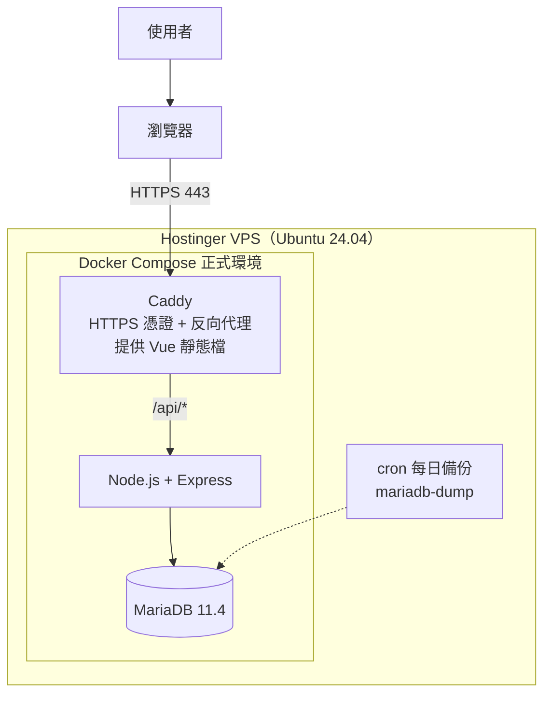

# 部署規劃

本文件描述把本專案部署上線的架構與步驟。**部署要等 [roadmap.md](roadmap.md) 的本機開發全部完成後才進行**；開發期間只要遵守下方「開發時就要遵守的原則」，之後部署就不需要回頭改程式。

部署目標是自己管理的 **Hostinger VPS（KVM 1）**，並保留改部署到 **Hostinger Cloud Startup** 的彈性（見最後一節）。

> 標記說明：完成並實際測過的步驟，在步驟前加上 ✅️。

## 開發時就要遵守的原則

這些原則讓同一份程式碼可以跑在本機、VPS 和 Hostinger Cloud Startup，在本機開發時就要做到：

- **資料庫統一用 MariaDB**，只使用 MariaDB 10.6 與 MySQL 8.0 都支援的功能（見 [database.md](database.md)「相容性」）。
- **API 不存狀態**：Session 存在資料庫，不存在記憶體或本機檔案；程式也不寫任何本機檔案（上傳、log 檔都不寫）。
- **設定全部來自環境變數**：資料庫連線用 `DB_HOST`、`DB_PORT`、`DB_NAME`、`DB_USER`、`DB_PASSWORD`，監聽的 port 讀 `PORT`；程式碼裡不寫死任何主機（例如 Docker 的 `db`）、密碼。
- **正式環境才需要的設定也用環境變數開關**：Cookie 的 `secure`、Express 的 `trust proxy`、錯誤訊息是否隱藏細節，都由 `NODE_ENV` 等環境變數控制。本機開發時關閉，部署時打開，不用改程式。
- **程式碼不依賴 Docker**：Docker 只是執行方式，`npm ci && npm start` 在任何裝了 Node.js 24 的地方都要能跑。
- **migration 是獨立指令**（`npm run migrate`），不在 API 啟動時自動執行。
- **log 一律輸出到 stdout／stderr**，由 Docker 或主機平台收集。
- **健康檢查**（`GET /api/v1/health`）用來確認 API 與資料庫正常。

## 正式環境架構（Hostinger VPS）

- **Caddy**：唯一對外的服務（只開放 80／443）。自動向 Let's Encrypt 申請與更新 HTTPS 憑證；`/api/*` 轉給 API，其餘路徑提供 Vue 建置後的靜態檔（找不到的路徑回 `index.html`，交給 Vue Router）。
- **Node.js + Express**：正式環境直接用 `node src/server.js` 執行（開發時才用 `node --watch`）。
- **MariaDB**：只在 Docker 內部網路，**不對外開放連接埠**。維運時用 `docker compose exec db mariadb -u 帳號 -p` 查看資料。
- 前端與 API 在同一個網域，不需要 CORS。

正式環境的 Docker 服務（`docker-compose.prod.yml`）：

| 服務 | 用途 | 對外連接埠 |
| --- | --- | --- |
| `caddy` | HTTPS、反向代理、Vue 靜態檔（映像檔建置時會先編譯前端） | `80`、`443` |
| `api` | Node.js + Express（`node src/server.js`） | 不對外 |
| `db` | MariaDB 11.4 | **不對外** |

> ⚠️ Docker 對外開放的連接埠會**繞過 ufw 防火牆**。正式環境的 `db`、`api` 絕對不要寫 `ports:`，只有 `caddy` 可以對外。

部署階段會新增的檔案：`docker-compose.prod.yml`、`Caddyfile`、`deploy/backup.sh`，以及（不進版本控制的）`docs/deployment-info.md`。

## 部署步驟

> 實際做完後，把遇到的問題與修正補回這份文件，之後的部署照著做。

### 一、購買與基本安全設定

1. 購買 Hostinger VPS KVM 1，作業系統選 **Ubuntu 24.04 LTS**（如果有內建 Docker 的範本就選它）。在本機產生 SSH 金鑰（`ssh-keygen -t ed25519`），把公鑰加到 hPanel 的 VPS 設定。記下 VPS 的 IP（記在不進版本控制的 `docs/deployment-info.md`，並加入 `.gitignore`）。
2. 用 root SSH 登入，建立一個一般使用者並給 `sudo` 權限，把 SSH 公鑰也複製給這個使用者。**先開一個新的終端機確認新使用者能用金鑰登入**，再進行下一步。
3. 修改 SSH 設定：禁止 root 登入（`PermitRootLogin no`）、禁止密碼登入（`PasswordAuthentication no`），重新啟動 SSH。一樣**保留原本的連線不要關**，另開終端機確認還登得進去，避免把自己鎖在外面。
4. 開啟防火牆 ufw：只允許 `22`（SSH）、`80`、`443`，然後 `ufw enable`。驗證：`ufw status` 只有這三個連接埠。
5. 開啟自動安全更新（`unattended-upgrades`），讓系統自動安裝安全性修補。
6. 安裝 Docker（範本已內建就跳過），驗證：`docker run hello-world` 成功。

### 二、網域與正式環境設定

7. 到網域的 DNS 設定新增一筆 A 紀錄，指向 VPS 的 IP（例如 `trello.你的網域`）。驗證：`nslookup trello.你的網域` 回傳 VPS 的 IP（DNS 生效可能需要幾分鐘到幾小時）。
8. 確認 API 的正式環境啟動方式：`NODE_ENV=production`、用 `npm start`（`node src/server.js`，不用 `--watch`）；Dockerfile 的正式環境映像檔用 `npm ci --omit=dev`，只安裝執行需要的套件。
9. 寫 `Caddyfile`：網域、`/api/*` 反向代理到 `api:3000`，其他路徑提供前端靜態檔並在找不到檔案時回 `index.html`。
10. 寫 `docker-compose.prod.yml`：`caddy`（只有它開放 `80`／`443`，映像檔建置時先用 Node 編譯前端再複製進去）、`api`（`npm start`，**不開放連接埠**）、`db`（**不開放連接埠**，資料卷保存資料）。Caddy 的憑證資料也要用資料卷保存，否則每次重建都要重新申請。
11. 確認正式環境的 Express 設定都已由環境變數打開：`app.set('trust proxy', 1)`（API 在 Caddy 後面，要靠這個才拿得到使用者真正的 IP，速率限制才不會把所有人當成同一個 IP 一起擋，也才能判斷原始請求是 HTTPS）、Session Cookie `secure: true`、`httpOnly: true`、`sameSite: 'lax'`；`csrf_token` Cookie 也設 `secure`；錯誤處理 middleware 不回傳錯誤細節。

### 三、部署與驗證

12. 在 VPS 上 `git clone` 專案，建立正式環境的 `.env`（`SESSION_SECRET` 用 `node -e "console.log(require('crypto').randomBytes(32).toString('hex'))"` 產生新的、資料庫密碼也另外產生，不要跟開發環境共用）。
13. `docker compose -f docker-compose.prod.yml up -d --build`，接著執行 `docker compose -f docker-compose.prod.yml exec api npm run migrate`。
14. 驗證：
    - `https://trello.你的網域/api/v1/health` 回 `200`，瀏覽器網址列顯示安全的 HTTPS。
    - `https://trello.你的網域/` 看得到 Vue 畫面。
    - 從自己的電腦連 VPS 的 `3306`、`3000` 連接埠都會失敗（代表資料庫與 API 沒有直接對外開放）。
15. 檢查正式環境的回應：`curl -i` 打一個不存在的 API 路徑與一個會出錯的情境，確認回的是 JSON 錯誤格式、沒有錯誤堆疊，也沒有 `X-Powered-By: Express` 標頭。
16. 在正式網址完整走一次：註冊 → 登入 → 建看板 → 建列表 → 建卡片 → 拖拉 → 重新整理確認順序 → 登出。

### 四、維運

17. 寫 `deploy/backup.sh`：用 `docker compose exec -T db mariadb-dump --single-transaction` 匯出資料庫並壓縮（`--single-transaction` 讓 InnoDB 在不鎖表的情況下匯出一致的快照），檔名帶日期，只保留最近 14 天；用 `crontab` 設定每天凌晨自動執行。驗證：隔天確認有新的備份檔產生。
18. **實際演練一次還原**：在本機用最新的備份檔還原到一個空的資料庫，確認資料完整。沒有實際還原過的備份，不能算是備份。
19. 備份檔不能只放在同一台 VPS（VPS 壞掉時會一起不見）：定期下載到自己的電腦，或開啟 Hostinger VPS 的備份／快照功能。
20. 安全性 HTTP 標頭：在 Caddy 加上 `header` 設定，讓前端靜態檔也有 HSTS、`X-Content-Type-Options`、`Referrer-Policy`、`Content-Security-Policy` 等標頭，部署後用安全檢測工具測一次。
21. 確認看 log 的方式：`docker compose logs -f api`、`docker compose logs -f caddy`，把常用指令寫進 `docs/operations.md`。
22. README 補上正式網址。

## 改部署到 Hostinger Cloud Startup

Cloud Startup 是代管主機：可以直接跑 Node.js 應用程式，資料庫是 MariaDB／MySQL 相容資料庫（連線埠 `3306`，用 phpMyAdmin 管理），但**沒有 PostgreSQL、也不能自己跑 Docker 和 Caddy**。只要開發時遵守上方的原則，就能直接改部署到這裡。

| 項目 | VPS | Cloud Startup |
| --- | --- | --- |
| 執行 API | Docker Compose 的 `api` 容器 | hPanel 的 Node.js 應用程式 |
| 資料庫 | Docker 的 `mariadb:11.4` | Hostinger 提供的 MariaDB／MySQL，用 phpMyAdmin 管理 |
| 連線設定 | `.env` | 把 hPanel 提供的資料庫資訊填進 `DB_*` 環境變數 |
| HTTPS | Caddy 自動申請憑證 | Hostinger 代管 |
| 前端靜態檔 | Caddy 提供 | 沒有 Caddy，改由 Express 提供：設定 `FRONTEND_DIST` 環境變數時，`app.js` 用 `express.static()` 提供 Vue 建置結果，非 `/api` 的路徑都回 `index.html`。這樣前後端仍然同網域，不需要 CORS。 |
| migration | `docker compose exec api npm run migrate` | 用 SSH／終端機執行 `npm run migrate` |
| 備份 | 自己寫 cron + `mariadb-dump` | Hostinger 的自動備份，加上定期從 phpMyAdmin 匯出 |
| 防火牆、系統更新 | 自己設定 ufw、unattended-upgrades | Hostinger 代管 |

`FRONTEND_DIST` 這段等真的要搬到 Cloud 時再實作（範圍很小）。實際的部署方式（從 GitHub 匯入或上傳檔案、怎麼設定環境變數）以 hPanel 當時提供的功能為準，做的時候再補進這一節。

> **已知的單一實例假設**：速率限制先用記憶體計數（只有一個 API 行程時是準的）。之後如果同時跑多個實例，要改成共享的 store，否則每個實例各算各的。

## 待確認事項

- [ ] 購買 Hostinger VPS KVM 1（確認首期與續約價格、付款週期），或直接使用 Cloud Startup。
- [ ] 網域：沿用現有網域的子網域（例如 `trello.你的網域`），或另外購買。
